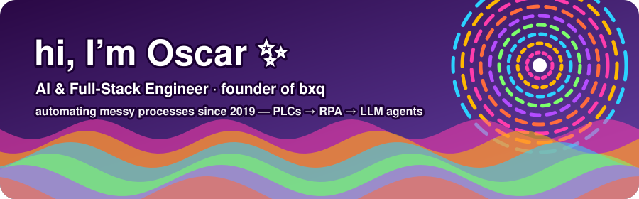

  

  <b>Oscar Omar Martínez Lujano</b> · Monterrey, MX 🌵 · remote-friendly 
  <a href="https://bxq.app">bxq.app</a> · <a href="https://www.linkedin.com/in/oscarmartinezl">LinkedIn</a> · <a href="mailto:oscar@bxq.app">oscar@bxq.app</a>

### 🌀 what I do

I take a messy manual process and turn it into software that runs on its own.

In 2016 that meant wiring Siemens PLCs to valves and sensors on a factory floor. From 2019 it meant RPA bots for some of Latin America's biggest companies. Today it means **LLM agents in production**: WhatsApp agents built on the Claude API that qualify leads, send quotes, collect payments and book meetings, and hand the conversation to a human when it matters.

  

### 🍄 bxq: the thing I'm building

**bxq** is a multi-tenant SaaS platform that small and mid-size businesses run on: CRM and sales pipeline, WhatsApp inbox, commerce, payments, Mexican e-invoicing and AI agents. One codebase hosts many businesses, each with its own roles, menus, dashboards and agents.

| piece | what it is |
|---|---|
| 🧠 **AI agents** | Claude agents with about 18 tools (quotes, Stripe payment links, meeting scheduling, pipeline moves, human escalation). Agents are versioned and sandboxed, with reply review and per-tenant AI budgets |
| 💬 **WhatsApp pipeline** | Cloud API with message bundling, media in and out, templates, opt-outs, an outbox, per-message cost tracking and Whisper transcription of voice notes |
| 🤖 **in-app assistant** | operates the API *as the user*, with the same permissions; its tools are generated from the API routes, and risky actions ask for confirmation first |
| 🛤️ **Rails 8 API** | shared-database multi-tenancy, JWT with refresh rotation, per-tenant roles & permissions, Solid Queue |
| 🖥️ **Next.js 16 admin** | a config-driven dashboard, permission gates, and a proxy so tokens never touch the browser |
| 📱 **native iOS app** | Swift / SwiftUI, push notifications for agent escalations, deep links. *Currently in active development* |
| 🚚 **delivery** | GitHub Actions on self-hosted runners, Kamal deploys to DigitalOcean, 900+ test files |

  

### 🌈 things shipped for clients

- 🏭 **Purchase-order bot for a Mexican steel group.** Sales reps chat their orders on WhatsApp. Claude structures each one, including the Mexican tax fields, and reads orders straight from PDFs and photos. Orders land in Salesforce and operations gets a Slack alert.
- 🌱 **[Plan 20·40](https://plan2040.org).** An end-to-end platform for an NGO supporting families in Coahuila. It tracks communities, families, cases, visits and life-plan goals to measure real impact, and takes donations through Stripe.
- ⛺ **[Glamping Co](https://glampingco.mx).** A catalog site with a three.js 3D model viewer, generated floor-plan PDFs and a WhatsApp quote flow.
- 👗 **farouche** & ☕ **Seltari.** Headless storefronts running on the bxq API, with React Three Fiber, maps and GSAP scroll storytelling.
- 📸 **272.** An Instagram feed planner embedded in Notion: drag to reorder, and the new dates sync back to Notion.

🔧 <b>the before times</b> (click me)

 

- **2016–2018 · field service engineer intern, Aselec.** Siemens S7-1500 PLC automation for a steel slitter line: control cabinets, valves, sensors and DC motors.
- **2019–2023 · RPA developer, Practia Global (EY engagements).** UiPath, Blue Prism and Power Automate bots for Televisa, Soriana, Alsea, Estafeta, Sodimac, Falabella and BanBif. I mapped each process into flowcharts and PDD/SDD documents before automating it.
- **2019–2022 · Power Apps developer, Anderssen Gauguin.** Power Apps, a SharePoint intranet and Power Automate flows.
- **2023–2024 · software developer, Neoris for CEMEX.** Power Platform apps on C#/.NET, a first taste of Angular, and the leap into TypeScript and Next.js.
- **B.Eng. Electronics Technologies & Robotics, UDEM.** I came for the robots and stayed for the software.

### 🎨 toolbox

`Ruby on Rails` `TypeScript` `Next.js` `React` `Swift / SwiftUI` `PostgreSQL` `Claude API` `WhatsApp Cloud API` `Stripe` `Salesforce` `Docker` `Kamal` `GitHub Actions` `DigitalOcean` `Vercel` `three.js` `UiPath` `C# / .NET`

I build with **Claude Code** every day: project instructions, custom skills, code review and CI gates. The AI moves fast, and I own the architecture and what ships.

<i>most of my code lives in private client repos. Ask me about any of it ✌️</i>

  

