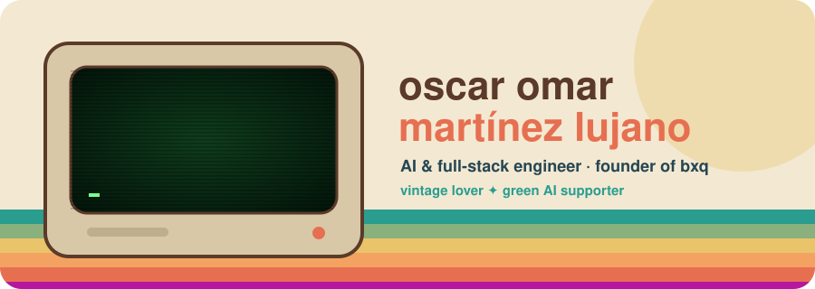
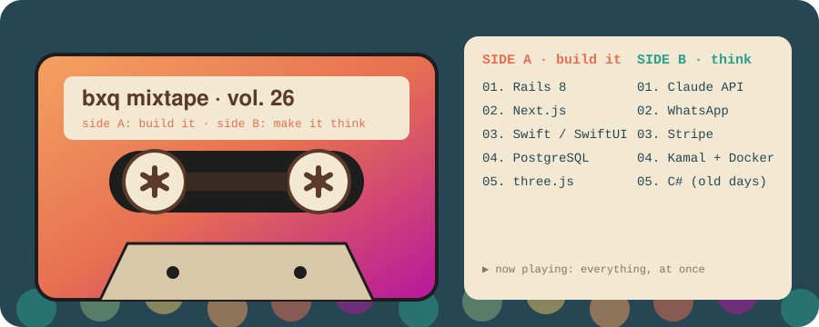
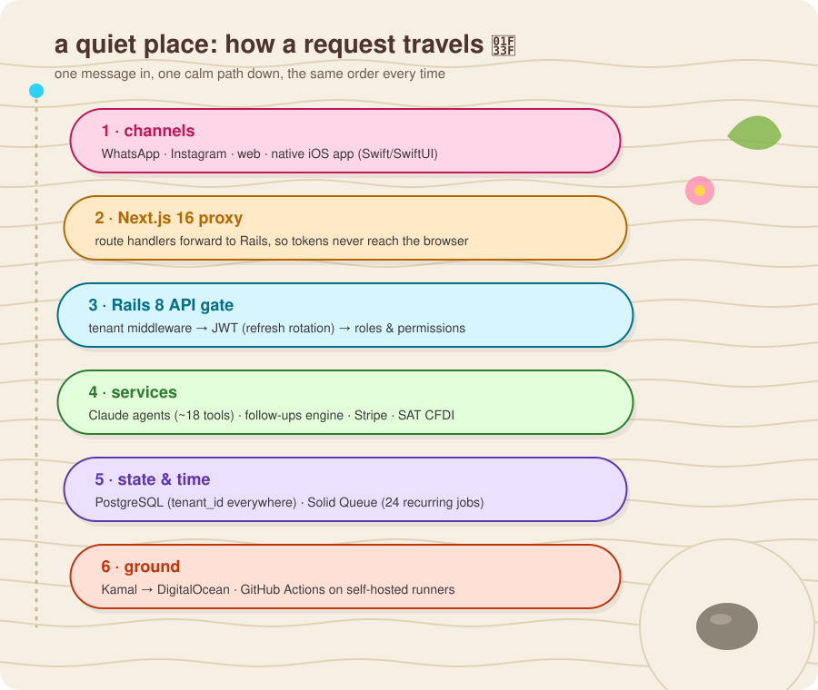
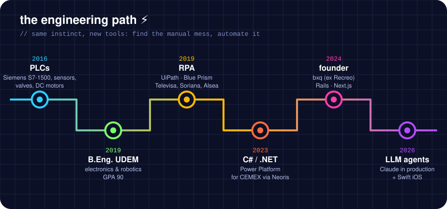
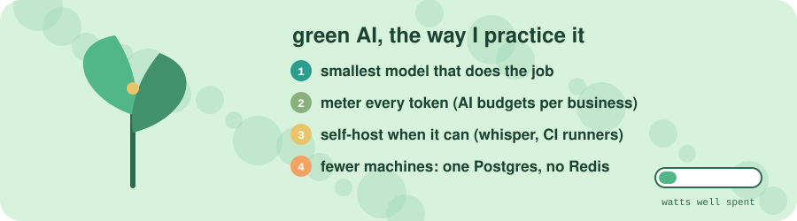

  

  
  
  

  I turn messy manual processes into software that <i>feels alive</i>. 
  Founder of <b>bxq</b> · LLM agents in production · Monterrey 🌵 · remote

  

<b>🕹️ press start: what's bxq?</b>

 

A multi-tenant platform that small businesses run on. Its AI agents answer WhatsApp, send quotes, collect payments and book meetings, and call a human when it matters. It comes with a web CRM and a native iOS app.

<b>🛰️ insert coin: what's next</b>

 

<b>📼 rewind: how I got here</b>

 

<b>🌈 hall of fame: client work</b>

 

- 🏭 **WhatsApp + Claude order bot** for a Mexican steel group: chats, PDFs and photos go in, Salesforce orders come out
- 🌱 **[Plan 20·40](https://plan2040.org)**: an impact-tracking and donations platform for an NGO in Coahuila
- ⛺ **[Glamping Co](https://glampingco.mx)**: a 3D lodge you can spin with your finger
- 👗 **farouche** & ☕ **Seltari**: storefronts that scroll like a story
- 📸 **272**: an Instagram feed planner that lives inside Notion

  

### 🛠️ a tiny creed for the craft

> **Code is craft.** Name things well, test what matters, leave it better than you found it. 
> **AI is a power tool, not a pilot.** I build with Claude Code every day, and I still own the architecture and every line that ships. 
> **Old things teach.** CRTs, cassettes and PLCs taught me that good machines are honest, durable and a little bit warm. 
> **Make people feel something.** Otherwise it's just a spreadsheet.

made with ♥ and phosphor green in Monterrey · most of my code lives in private client repos, so ask me anything ✌️

